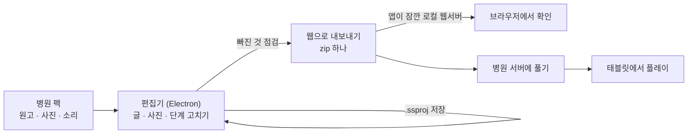

# 병원 검사 연습 — 발달장애인을 위한 인터랙티브 소셜스토리

발달장애인과 보호자가 병원 검사(흉부 엑스레이, 복부 초음파, 심전도, 채혈, 정맥주사)를 **미리 경험하고 연습**하는 태블릿 웹 콘텐츠와,
그 콘텐츠를 병원마다 고쳐 납품하는 **Electron 편집기**입니다.

> 회사에서 진행 중인 프로젝트의 공개본입니다. 병원 원고와 사진, 디자인 시안, 제안 문서, 발표 자료는 고객 자료라 뺐습니다.
> 그래서 이 저장소만으로는 바로 실행되지 않습니다 (아래 「실행」).

---

## 무엇을 만들었나



| 부분 | 하는 일 |
|---|---|
| **플레이어** | 검사 5종을 단계별 사진과 문장으로 미리 봅니다. 연습 7종(가만히 있기, 심호흡, 볼 곳 고르기, 이름 부르기, 부위 고르기, 패드 붙이기, 순서 고르기)을 직접 해 봅니다. 문장을 읽어 주고(음원이 없으면 기기 음성), 다 읽으면 빛 고리가 다음에 누를 곳을 가리킵니다. 묶음을 마치면 칭찬 스티커를 받습니다 |
| **보호자 기능** | 처음 셋업(함께 가는 사람, 아이 이름, 바늘과 피 사진 표시), 단계 고르기, 「연습 먼저 하기」, 병원 공용 태블릿용 「다음 사람을 위해 지우기」 |
| **편집기** | 페이지 목록, 사진과 영상 바꾸기, 화면에서 끌어서 배치 조정, 글 고치기(쓰면 안 되는 표현 알림), 단계 순서와 묶음 바꾸기, 되돌리기와 다시 하기, 빠진 것 목록, 2분마다 자동 저장, 기기 크기별 미리보기, 태블릿 세로·가로 배치(페이지 목록 서랍, 아래 고치는 칸 2단) |
| **웹으로 내보내기** | 상대 경로 zip 하나로 묶어 서버의 아무 하위 폴더에 풀어도 돌게 합니다. 보내기 전에 앱이 127.0.0.1 에서만 잠깐 웹서버가 되어 하위 폴더에 푼 것처럼 브라우저로 보여 줍니다 |
| **프로젝트 파일 `.ssproj`** | 자체 포맷입니다. 파일마다 deflate 뒤 AES-256-GCM 으로 암호화하고, 인증 태그로 망가지거나 고친 파일을 열 때 알아챕니다 |
| **개발용 동기화** | 개발 서버의 HMR 웹소켓을 그대로 써서 태블릿과 PC 를 잇습니다(QR 로 접속). 연결한 기기 목록을 보고, 기기 화면을 PC 에서 그대로 봅니다(기기에서 rrweb 로 기록해 PC 에서 재생). 납품 빌드에는 들어가지 않습니다 |

## QA 관점에서 본 이 프로젝트

**1. Playwright E2E — `app/tests/`**

- 테스트 정의 83개(`flow` 65 · `ssproj` 8 · `structure` 7 · `export` 3)를 기기 크기 셋(폰 375×812, 태블릿 768×1024, 가로 태블릿 1280×620)에서 돌립니다.
  `yarn test:safari` 는 같은 점검을 WebKit(아이폰, 아이패드)으로 돌립니다.
- 납품 빌드를 띄워 검사 5종을 표지부터 스티커판까지 끝까지 갑니다. 연습 종류마다 터치 조작(누르고 있기, 끌어다 놓기)을 합니다.
- 정상 흐름보다 **경계와 회귀**를 더 많이 봅니다. 실제 테스트 이름 몇 개입니다.
  - 「연타 막기: 스티커판 "첫 화면으로"를 빨리 두 번 눌러도 첫 화면의 검사가 열리지 않음」
  - 「단계를 건너뛰고 마지막만 "했어요": 건너뛴 묶음 스티커는 안 붙고, 첫 화면도 "다 했어요"가 아님」
  - 「저장값: 형이 맞아도 범위 밖이면 기본값 (글자 크기 0이면 글자가 모두 사라졌음)」
  - 「저장값이 깨져도 화면이 멈추지 않음」
  - 「예전 호칭 "선생님"이 저장된 기기는 "학교 선생님"으로 (메뉴에 눌린 칩이 있음)」
- `.ssproj` 저장과 열기 왕복, 내보낸 zip 을 로컬 서버로 다시 여는 것까지 시험합니다.
  그래서 파일 포맷, 내보내기, 확인 서버(`src/main/ssproj.ts` · `exportWeb.ts` · `webCheck.ts`)는 **Electron 을 부르지 않게** 짰습니다.

**2. 원고 검사기 — `yarn check:content`**

- 병원 팩마다 원고 구조 오류, 쓰면 안 되는 표현, 사진과 음원 준비 상태, 병원에서 받아야 할 파일 목록을 냅니다.
- 쓰면 안 되는 표현은 거짓 약속(「안 아파요」), 강한 금지, 부정 명령, 감정을 막는 말입니다. 규칙은 `src/renderer/src/content/rules.ts` 한 곳에 두고 **검사기(Node)와 편집기(브라우저)가 같은 파일을 씁니다.**
- 오류가 있으면 `yarn build` 가 멈춥니다. `--strict` 는 납품 직전용으로 임시 사진과 없는 자료까지 오류로 봅니다.

**3. 원인을 고친 버그 예**

- 아래 버튼이 모든 페이지에서 같은 자리라, 두 번 누르면 다음 페이지 버튼까지 눌려 단계를 건너뛰었습니다.
  화면이 열린 직후 0.7초만 누름을 무시하는 `useTapGuard`(`src/renderer/src/lib/tapGuard.ts`)로 막고, 위 「연타 막기」 테스트로 다시 못 지나가게 했습니다.

## 기술

Electron 44 · electron-vite 5 · Vite 7 · React 19 · TypeScript · PixiJS 8(효과) · rrweb(개발용 화면 보기) · Playwright · Node 22.18+(`.ts` 규칙 파일을 Node 가 바로 읽음)

## 실행

```bash
cd app
yarn install
yarn typecheck
```

- `yarn typecheck` 말고는(`yarn dev`, `yarn build`, `yarn app`, `yarn test:e2e`, `yarn check:content` 등) **병원 팩**(`hospitals/<병원id>/` 의 `hospital.json`, `exams/`, `media/`)이 있어야 돕니다. 공개본에는 없습니다.
  팩 구조는 `app/tools/hospital-pack.mjs` 와 `app/src/renderer/src/content/types.ts` 에 있습니다. 기본 병원 id 는 `SampleHospital` 입니다.
- 공통 그림 가운데 디자인 시안에서 자른 PNG 는 뺐습니다. 코드로 그린 SVG 스티커와 직접 만든 효과음 하나만 남아 있습니다.
- 코드 주석이 가리키는 `CLAUDE.md` 와 `docs/` 는 회사 쪽 문서라 이 저장소에 없습니다.

## 폴더

```
app/
  src/main/        Electron 메인 — 프로젝트 열기와 저장, .ssproj, 웹으로 내보내기, 내보낸 zip 확인 서버
  src/preload/     렌더러에 열어 줄 API
  src/renderer/src/
    pages/         첫 화면, 검사 표지, 단계, 완료, 스티커판
    practice/      연습 7종
    editor/        편집기 화면 (페이지 목록, 사진 편집, 점검 창, 내보내기 창)
    content/       원고 타입, 읽기, 원고 규칙(검사기와 같이 씀)
    components/    보호자 메뉴, 셋업 창, 스티커 알림 등
    lib/           읽어 주기, 소리, 저장값, 연타 막기, 화면 맞춤
    fx/            빛 고리, 손가락 안내 효과
    devsync/       개발용 태블릿과 PC 동기화
  tools/           개발 서버, 병원별 빌드, 원고 검사기, 새 병원 만들기, 설치 파일 만들기, 아이콘 만들기
  tests/           Playwright E2E
```

## 규모와 만든 방식

- 코드 약 14,600줄, 95개 파일 (`src` · `tools` · `tests`). 2026-10-02 에 시작했습니다.
- 플레이어, 편집기, 내보내기, 테스트까지 혼자 설계하고 만들었습니다. Claude Code 와 같이 만들었습니다. 무엇을 어떻게 동작하게 할지는 직접 정하고 화면과 테스트로 검수했습니다. 코드 주석의 「본인 요청」, 「본인 결정」이 그 기록입니다.
